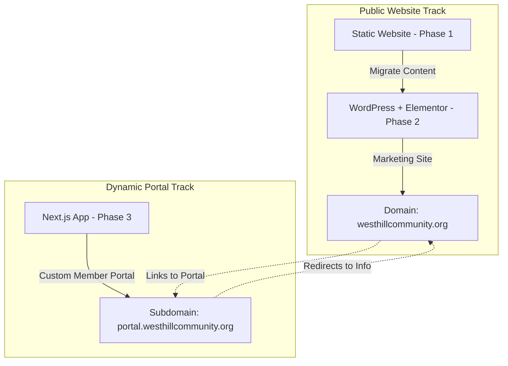

# Architectural Evaluation: Next.js vs. Static HTML vs. WordPress

**Project**: West Hill Community Centre Web Platform  
**Evaluation Date**: June 2026  
**Roadmap Phases**:
1. Phase 1: Launch Community Centre Website (Active)
2. Phase 2: Migrate to WordPress + Elementor (Content management for staff)
3. Phase 3: Build Member Portal (Volunteer tracking, registration, dynamic portal)

---

## 1. Architectural Comparison Matrix

| Criteria | Static HTML/CSS/JS | WordPress + Elementor | Next.js (React Framework) |
| :--- | :--- | :--- | :--- |
| **Initial Deployment Speed** | **Fastest (Days)** No compile steps, templates are already structured. | **Medium (Weeks)** Requires database setup, theme configuration, and page building. | **Slowest (Weeks/Months)** Requires translating HTML/CSS to React components and managing state. |
| **Monthly Maintenance Cost** | **Lowest ($0 - $5/mo)** Can be hosted on basic shared hosting, GitHub Pages, or Netlify. | **Low-Medium ($5 - $15/mo)** Requires standard hosting with a database (e.g., Hostinger WordPress hosting). | **Medium-High ($15 - $50+/mo)** Requires Node.js serverless/VPS hosting (e.g. Vercel, AWS, or Hostinger VPS). |
| **Operational Maintenance Friction** | **None** No plugins to update, no database to corrupt, no server patches. | **Moderate** Requires regular updates to WordPress core, Elementor, and security plugins. | **Low-Moderate** Requires NPM package updates, Node version upkeep, and build-time monitoring. |
| **Content Editing (Non-Technical Staff)**| **High Barrier** Requires editing HTML or editing raw JSON files directly in the codebase. | **Easiest (No-Code)** Visual drag-and-drop editing with Elementor; standard WP posts for news/events. | **High Barrier** Requires editing codebase files, OR building and configuring a Headless CMS (additional cost/setup). |
| **SEO & Performance (Core Web Vitals)** | **Excellent** Instant page loading, lightweight assets, fully crawlable markup. | **Good (if optimized)** Can become bloated with heavy plugins, but fast with caching and lazy loading. | **Excellent** Server-Side Rendering (SSR) and Static Site Generation (SSG) provide premium performance. |
| **Scalability for Member Portal (Phase 3)** | **Poor** Not built to handle authentication, user state, database queries, or secure dashboards. | **Moderate** Can use third-party membership plugins, but becomes complex and bloated. | **Excellent** Perfect for interactive dashboards, secure APIs, databases, and custom user states. |

---

## 2. In-Depth Option Analysis

### Option 1: Static HTML/CSS/JS (Current Phase 1)
* **Pros**: Incredibly fast load speeds, zero server-side vulnerabilities, and essentially free hosting. Excellent for launching Phase 1 rapidly.
* **Cons**: To edit a program description or add a new event, someone must write HTML or modify `events.json`. For a community centre run by volunteers and non-technical staff, this is unsustainable for daily operations.
* **Portal Scalability**: Incapable of serving as a secure member portal (no native backend, database session tracking, or secure user login).

### Option 2: WordPress + Elementor (Phase 2 Roadmap)
* **Pros**: Once configured, non-technical staff can add events, update programs, post newsletters, and swap banner images through a user-friendly dashboard. 
* **Cons**: Vulnerable to security exploits if plugins/core are not updated. Page speed requires optimization (already mitigated by custom optimization rules in `functions.php`).
* **Portal Scalability**: While WordPress *can* handle membership plugins (like MemberPress or Ultimate Member), building a complex custom digital portal for volunteer matching and registrations inside WordPress can quickly feel like forcing a blogging engine to act as a custom application.

### Option 3: Next.js (React App Framework)
* **Pros**: Next.js is the industry standard for modern web application development. Its serverless routing, API endpoints, and React ecosystem make it the best tool for building dynamic portals.
* **Cons**: Rebuilding the current static site into Next.js right now would require significant rewrite time, slowing down Phase 1. Furthermore, Next.js does not have a native content editing interface. To allow staff to edit pages, you would have to integrate a Headless CMS (like Sanity or Contentful), which adds API limits and configuration overhead.
* **Portal Scalability**: Unrivaled. Ideal for secure login, volunteer dashboards, dynamic calendar matching, and program registrations.

---

## 3. Recommendation & Roadmap Alignment

Converting the entire public website to Next.js at this stage is **not recommended**. It would increase immediate deployment friction and maintenance costs without solving the immediate operational need (non-technical content management).

Instead, we recommend a **Decoupled (Two-Tier) Architecture** as you progress through the roadmap:

### Justification:

1. **Phase 1 Speed (Static HTML)**: Proceed with the static HTML/CSS/JS deployment. This gets the website live immediately on Hostinger's standard static hosting at the lowest cost, while you finish designing the subpages on the `develop` branch.
2. **Phase 2 Operational Feasibility (WordPress)**: Migrate the marketing site to WordPress + Elementor. This satisfies the requirement of letting your team manage day-to-day content (flyers, news, programs) easily without paying developers for minor edits. The files prepared in `westhill-theme/` and `westhill-core/` make this migration fast.
3. **Phase 3 Scalability (Next.js on a Subdomain)**: When you are ready to build the dynamic Member Portal (Track C), build it as a separate, dedicated Next.js application hosted on a subdomain (e.g., `portal.westhillcommunity.org`).
   * **Why this is best**: The public marketing site remains simple, fast, and easy for staff to edit in WordPress. The complex app logic (volunteers, logins, database queries) is kept in a separate, secure, high-performance Next.js repository. If the portal undergoes maintenance or updates, the main website remains 100% online and unaffected.
